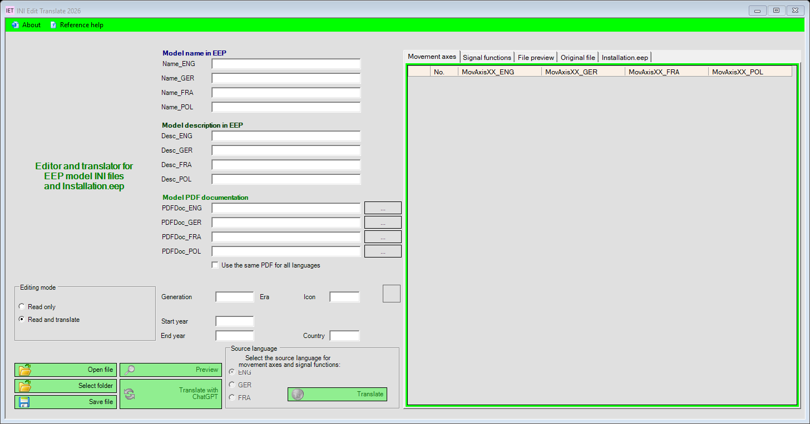

# INI Edit Translate 2026

## 2.1.55: external default dictionary (prepared locally)

The user's 30 reference terms are supplied as a semicolon-separated UTF-8 CSV:
`%LOCALAPPDATA%\UGSo\IET2026\translation-dictionary.csv`.
Header: `Deutsch;ENG;FRA;POL`. The first start creates the file; existing files
are never overwritten. Add rows or correct translations; each new translation
reloads the file. Matching external entries take priority over embedded defaults,
existing model vocabulary and the selected online provider. Whole phrases work
in all four source languages. Fully covered texts require no online request.
Unknown proper names in model names remain unchanged. CSV entries cannot override
DR, DB, constructor identifiers, technical types, underscore identifiers, version
notes or `[e]`. Empty target cells use the fallback. Missing or unreadable files
remain untouched and the embedded seed list is used. Online results are never
automatically written to the file. Existing Info_trans tables and database are retained.
116 local checks passed, without live API calls. No public 2.1.55 release yet.

## Version 2.1.54: railway abbreviations in Info_trans

Info_trans adds the **Railway abbreviations** tab with 14 entries:
Bf, Hbf, Hp, Gbf, Rbf, Abzw, BÜ, Stw, EG, OL, Gl., Bstg., DWW and Kr.
The table shows German, English, French and Polish, including documented foreign
abbreviations. The previously empty Kr. row is completed for a track crossing.
Clicking a cell copies its contents, as in the existing reference tables.
The table is read-only, columns can be sorted and long text wraps.
The German tab name is **Bahnabkürzung**; the French name is **Abréviations ferroviaires**.
The table is embedded in Info_trans. An existing external
`help/railway-abbreviations.csv` can still be used. This reference table
does not change automatic translation rules. Backup created before changes;
dictionary, database, settings, credentials and the external constructor list are retained.
The update ZIP uses only paths accepted by the 2.1.53 updater. Download and package
validation are separate phases; 100% is shown only after successful validation.
The dialog shows failure details and allows retrying. Both projects retain .NET
Framework 4.8 and use its out-of-process Visual Studio designer. Info_trans explicitly
references System.Configuration. Reload the solution after these changes.
Design-time compilation and WinForms DesignSurface loading were checked;
Visual Studio itself was not controlled remotely.

114 local checks passed, including table contents and DE/EN/FR layout at
100 and 150 percent scaling, without live API calls.


## Version 2.1.53: railway abbreviations and constructor identifiers

20 railway abbreviations now use a fixed local mapping in model names and in
texts translated through the selected provider. EW means single turnout without
requiring an angle. For example, `GK3 DKW DR DB (V8)[e]EEP16.2` becomes
`GK3 TJD DR DB (V8)[e]EEP16.2` in French.

The supplied initial list contains 272 unique three-character constructor identifiers.
The first application start creates an external UTF-8 file:
`%LOCALAPPDATA%\UGSo\IET2026\constructor-codes.txt`.
Add new identifiers with two letters and one digit, one per line, then restart the app.
Updates never overwrite this user file. Additions are merged with the supplied base
list. Blank lines, comments and invalid entries are ignored. Unreadable files are
retained and the base list remains available as a fallback.
Identifiers are retained anywhere, with or without parentheses. Generic recognition
of additional identifiers remains active. DR, DB, type labels, version notes such
as `(V8)` or `(v8.2)`, EEP versions and `[e]` remain unchanged.

| DE | EN | FR | PL |
| --- | --- | --- | --- |
| DKW | DSS | TJD | Rkpd |
| EKW | SS | TJS | Rkp |
| EW | single turnout | BS | Rz |
| ABW | contrary-flexure turnout | ABW* | Rłd |
| IBW | similar-flexure turnout | IBW* | Rłj |
| BW | locomotive depot | dépôt de locomotives | lokomotywownia |
| Bf | station | gare | stacja |
| Hbf | main station | gare principale | dworzec główny |
| Hp | halt | halte ferroviaire | przystanek osobowy |
| Gbf | freight station | gare de marchandises | stacja towarowa |
| Rbf | marshalling yard | gare de triage | stacja rozrządowa |
| Abzw | junction | bifurcation | posterunek odgałęźny |
| BÜ | level crossing | passage à niveau | przejazd kolejowo-drogowy |
| Stw | signal box | poste d’aiguillage | nastawnia |
| EG | station building | bâtiment voyageurs | budynek dworca |
| OL | overhead line equipment | caténaire | sieć trakcyjna |
| Gl. | track | voie | tor |
| Bstg. | platform | quai | peron |
| DWW | three-way turnout | branchement à trois voies | rozjazd potrójny |
| Kr. | diamond crossing | traversée de voies | skrzyżowanie torów |

*French retains ABW/IBW until their equivalents have been reviewed.
Other entries use documented abbreviations or written-out translations, rather
than claiming a universal abbreviation standard.
Additional source abbreviations: DS/DSS/SS, TJD/TJS/BS, Rkpd/Rkp/Rz/Rłd/Rłj,
PO, Jn, PODG, LC, PN, BV and OLE. Ambiguous Polish ST/St is not mapped.
Hp means a passenger halt here; Kr. means a track crossing.
Technical types such as `Hp0`, `DKW190` and identifiers such as `DKW_190` are not split.

Reviewed terms are temporarily replaced with protected placeholders for online
translation and restored in the target language only after validation, including
when English is the intermediate language. Errors or changed placeholders prevent
partial application. Original files, settings and credentials are retained.
Backup created before changes. MyMemory remains the default for new configurations.

111 local checks passed, covering all 272 identifiers, DE/EN/FR/PL, import/save/reload,
version notes and failure cases, without live API calls.
The full ZIP includes `docs/railway-glossary.md` and `docs/constructor-codes.txt`.


## Version 2.1.52: descriptive words in model names

Descriptive words are now translated in model names, including when descriptions
are empty. “Haus Helios Typ4 UD1” becomes **House / Maison / Dom Helios Typ4 UD1**.

Name translation uses a limited, reviewed local word list to protect proper names.
Unknown words and name components are retained and never sent to an online service
for name translation. This is not general automatic proper-name recognition:
additional descriptive words require review. Existing names without a recognized
descriptive component are not overwritten. Type labels, constructor codes, EEP versions,
`[e]`, separators and the spelling of protected components are retained.
The railway abbreviations still being collected are not added in this change.

Descriptions still use the selected provider. Model names and descriptions are
applied together only after success; failures retain existing contents.
The provider-neutral button is now **Translate texts**.

**MyMemory/translated.net is the default for new configurations.**
Existing provider choices, API keys, accounts and models are retained.
To switch deliberately, choose **About → Settings → Translation settings → MyMemory → Save**.

105 local checks passed, covering DE/EN/FR/PL, empty descriptions, protected names and
codes, failure handling and save/reload. Backup created; original files and credentials retained.

## Version 2.1.51: folder-selection hint

Selecting a folder in the tree shows **“Please select an INI file.”** Loaded model
texts, tables, preview and selected file are retained. A directory is no longer
read as a file and no translation is started.

This applies to the root and arbitrary subfolders, including folders named with
an `.ini` extension. Missing files and other file types show the same selection hint.
Only an existing INI file is opened; uppercase `.INI` is supported too.
The selected tree node is used instead of the pointer position, including keyboard
navigation. The hint is available in German, English and French.

101 local checks passed, including retained data on folder selection in all three
languages and opening an INI without pointer hit testing. Backup created;
personal data and credentials are retained.

## Version 2.1.50: protect EEP controls, constructor codes and versions

`[e]` remains an EEP line-break control, never a translated word or an actual newline.
Exact spelling, count and order of protected markers are validated.

Constructor codes are recognized by letter/digit patterns without a fixed name list,
including `(GK3)`, `(AG3)`, `(DL1)` and legacy bare codes at the start, middle or end.
No code is added when none exists. Ordinary additions such as `(Winter)` remain
translatable. Unusual letter-only codes cannot reliably be distinguished from
ordinary words without an additional list.

Game versions such as `EEP16.2`, `eep16.2` and `EEP 16.2` retain their case and punctuation.
MyMemory never receives protected segments for translation; changed or invented codes
and controls in OpenAI/ChatGPT results are rejected. Existing rollback remains active.

A configuration entry introduced in 2.1.49 could prevent application startup.
This is fixed and covered by a test of the shipped configuration.
**If 2.1.49 does not start:** Back up `INI Edit Translate 2026.exe.config`,
download the additional configuration asset from release 2.1.50, rename it to
`INI Edit Translate 2026.exe.config` and replace the file beside the EXE.
Start the editor and install the normal 2.1.50 update. Do not replace INI files,
databases or personal settings.

99 local checks passed. An isolated installation test containing a leading code,
game version, parenthesized code and two `[e]` controls was translated through real
MyMemory calls, saved and reloaded. Original files and credentials are retained.

## Version 2.1.49: keep the last folder

Enable **Keep last folder** under **About → Settings**, then **Save**.
The last selected directory is retained across restarts and updates.
The folder tree and the model INI / Installation.eep file dialogs start there again.
No file is opened or translated automatically.

The option is disabled by default. If a saved folder or network drive is unavailable,
a message is shown and the path is retained for the next start. Existing data and
credentials are retained. 94 local checks passed, including save/reload, opt-out,
unavailable folders and DE/EN/FR layout at 100/150 percent scaling.

## Version 2.1.48: translate installation set titles again

Names and descriptions for all five installation sets, `Install_00` through
`Install_04`, are translated again. Only model names in the model section remain
protected. Source texts are retained; German and French still use English as the
intermediate language.

All five translation buttons and automatic import share the verified field mapping.
The second set button now edits its own fields. A set is applied only after its
complete translation; errors and cancellation retain its names and descriptions.

91 local checks passed. An isolated installation set named “Detailmodell
Großdiesellokomotive V140 001 DRG” was translated through real MyMemory calls,
saved and reloaded; model names and an extra INI field were retained. The file on
the remote gaming computer was not modified.

## Version 2.1.47: MyMemory and English as the intermediate language

Select OpenAI API, ChatGPT plan or **MyMemory** under **Options → Translation settings**.
MyMemory requires internet access but no key or account. An optional email address is
sent with each request: the provider allows 5,000 characters daily anonymously, up to
50,000 with a valid email. Each target language counts separately. Long text is split
into sections up to 500 UTF-8 bytes. A temporary cache avoids repeats within one operation.

German is the default. The selected interface language sets the initial source language;
axes/signal functions retain their source selector. German and French are translated
to English first; other target languages use that English intermediate text.
This applies to all providers. The selected source text and model names are retained.

MyMemory may store submitted texts long term. The application uses only the translation
query and does not submit additional dictionary entries. There is no automatic provider
switch. Existing API keys, ChatGPT connections, models and dictionaries are retained.
INI saving retains Polish characters through Unicode; when necessary, the backed-up
output is saved as UTF-16 with BOM. Actual EEP processing of this encoding was not tested.

90 local checks passed. The supplied sample INI was imported, translated through real
MyMemory calls and saved as a copy; the original remains unchanged. Review machine
translations of technical terminology before use.

[MyMemory API](https://mymemory.translated.net/doc/spec.php) ·
[Usage limits](https://mymemory.translated.net/doc/usagelimits.php) ·
[Data usage](https://mymemory.translated.net/terms-and-conditions)

## Version 2.1.46: retain finalized stream text

If the final completion event omits translation text, the app now considers earlier
finalized `response.output_item.done`, `response.content_part.done` and
`response.output_text.done` events. Nothing is applied before `response.completed`
with completed status. Accumulated deltas may undergo full JSON/language validation
only then. Deltas without terminal success, errors, interruptions, refusals and gapped text
parts are never treated as a successful translation.

Empty output has a dedicated diagnostic with transport and fixed event counts,
without response text, tokens or user identifiers. The actual remote event sequence
still requires confirmation. 78 local checks passed without live API calls.
Model names and original data are retained.

[OpenAI Docs on streaming events](https://developers.openai.com/api/reference/resources/responses/streaming-events).


## Version 2.1.45: translation JSON output

Instructions now explicitly request a JSON object with the three target-language keys;
the strict schema remains enabled. A single JSON Markdown fence may be removed before
the same complete language validation. Commentary, broken JSON, duplicate or extra
language keys are rejected.

Diagnostics distinguish translation output, API response, token response and identity
keys instead of a generic JsonReaderException. Raw responses and credentials are never
shown. 75 local checks passed without live API calls. The reported error's exact origin
still requires confirmation on the remote machine. Model names remain unchanged.


## Version 2.1.44: ChatGPT translation response handling

The app explicitly requests an event stream and validates the body instead of rejecting
it solely because Content-Type is missing or different. Valid terminal SSE events and
fully completed Responses JSON envelopes are processed. HTML, error objects, incomplete
and oversized responses never replace text. Copyable diagnostics use fixed media/body
categories without tokens or raw server messages.

Requests retain `store: false`, `stream: true` and array input as required by
[OpenAI Docs](https://developers.openai.com/siwc/token-sharing-open-source/preview-limitations).
73 local checks and 43 updater checks passed without live API calls. The next remote
test is needed to establish which response that machine actually receives.


## Version 2.1.43: update process access failure

If Windows denies access while waiting for the editor to exit, the updater proceeds
only after the local process list confirms that the PID is absent. A running process,
failed enumeration or timeout prevents installation. Normal identity checks remain.
Future updates use the updater from the newly revalidated package.

**One-time repair for an affected older updater:** close the editor, back up its existing
`IET.Updater.exe`, and replace only that file beside the editor EXE with the individual
download from the GitHub release. Restart the editor and select **About → Check for updates**.
Do not overwrite data, dictionaries or settings with the entire ZIP. The standalone
updater is included in `SHA256SUMS.txt`.


## Version 2.1.42: preserve model names

Translation now preserves all four model names in model INI files and Installation.eep.
Only descriptions, movement axis labels and signal texts are translated; model names
are not sent to OpenAI. The intended conversion of underscores to spaces during import
is retained. Incorrect language/section assignments in installation descriptions are fixed.

Errors during translation now offer **Copy error**. Stream errors include validated
error codes; invalid response formats have separate messages. Tokens and raw server
messages are never displayed. The reported ChatGPT failure's root cause remains unconfirmed.


## Version 2.1.41: sign-in and model catalog diagnostics

Errors now identify the failed step. Confirmed sign-in is distinguished from a
subsequent model catalog failure. **Copy error** copies the message, HTTP status,
validated error code and request ID, without tokens or raw server messages.
Account restrictions, temporary unavailability, network failures and unexpected
catalog formats have separate messages in DE/EN/FR. This update helps diagnose the
reported remote failure; its cause is not yet confirmed. Settings, API keys and
connections are retained.

[Windows ZIP v2.1.54](https://github.com/rockbaer2007/ini-edit-translate-2026/releases/download/v2.1.54/INI-Edit-Translate-2026-v2.1.54-windows.zip) · [Release and SHA-256](https://github.com/rockbaer2007/ini-edit-translate-2026/releases/tag/v2.1.54)

## Version 2.1.40: ChatGPT sign-in

Includes the editable application-path fix from 2.1.39.

Open **Options → OpenAI translation** and select **Use ChatGPT plan**.
Choose **Continue with ChatGPT**, sign in through the system browser and authorize
plan usage yourself. Select a model available to that account and **Save**.
**Another account** adds a separate connection; **Sign out** disconnects only the selected one.

Selected model texts are sent to OpenAI. This mode uses your existing ChatGPT
allowance and app permission, with no separate unlimited allowance.
**Manage usage** opens ChatGPT usage settings. Account eligibility is checked during
real sign-in. Errors and plan limits never trigger an automatic switch to the separately billed API.

The existing API key is retained. OAuth credentials are stored separately with
Windows DPAPI encryption in `%LOCALAPPDATA%/UGSo/IET2026/chatgpt-session.dat`.
No API key is needed for ChatGPT sign-in. Known API quota and rate-limit errors now
have separate messages.

All 63 local checks passed using simulated OpenAI responses and an isolated local callback.
Real account authorization and translation still need testing.
[Release and verification](https://github.com/rockbaer2007/ini-edit-translate-2026/releases/tag/v2.1.40).
[Official sign-in contract](https://developers.openai.com/siwc/token-sharing-open-source/sign-in).

[Deutsch](README.md) · [Français](README.fr.md) · [Documentation](https://opensource.ugso-software.de/en/eep/ini-edit-translate-2026/)

Windows editor and ChatGPT translator for EEP model INI files and `Installation.eep`,
developed by Uwe Grimm / UGSo Software. Version **2.1.54.0**.



## Features

- Edit model names and descriptions in English, German, French and Polish.
- Work with movement axes, signal functions, PDF references and model metadata.
- Edit installation sections and compare the original file with the output preview.
- Translate directly from the source language into the other three languages using OpenAI.
- Cancel translation; reject incomplete responses and changed placeholders while preserving existing texts.
- Automatically back up existing INI files before overwriting them.
- Export complete tables as tab-separated UTF-8 files with a BOM.
- Reviewed German, English and French interface texts.

**Manual GitHub updates with confirmed installation are available.** There is no automatic startup check.
Google, LEO, Linguee and DeepL are no longer translation providers.

## Download

[Download Windows ZIP v2.1.54](https://github.com/rockbaer2007/ini-edit-translate-2026/releases/download/v2.1.54/INI-Edit-Translate-2026-v2.1.54-windows.zip) · [GitHub release and SHA-256](https://github.com/rockbaer2007/ini-edit-translate-2026/releases/tag/v2.1.54)

Extract the complete ZIP and run `INI Edit Translate 2026.exe`. Requires Windows 11
and .NET Framework 4.8; Visual Studio is only needed to build from source.
Keep DLLs and language folders together. No installer is required.

## Build and use

Windows 11, Visual Studio 2026, the .NET desktop workload and .NET Framework 4.8 Developer Pack.

```powershell
nuget restore "INI Edit Translate 2026.sln"
MSBuild.exe "INI Edit Translate 2026.sln" /t:Build /p:Configuration=Release
```

Run `Ini Edit - Translate/bin/Release/INI Edit Translate 2026.exe`. Keep its DLLs
and language directories together. This repository does not include a ready-made installer.

Open **About → Settings → Translation settings** and select MyMemory, OpenAI API or ChatGPT plan. For API access, enter your key and model
(default: `gpt-4.1-mini`). Start by opening a backup copy in **Read only** mode.
Choose **Read and translate** or use the translation buttons when ready. Review the
source language and output preview before saving.

OpenAI requires internet access and separate API billing. A ChatGPT subscription does
not replace API billing. Live API access and generated translation quality still need
verification with your own account.

The information dialog selects the reviewed `Info.de.rtf`, `Info.en.rtf` or `Info.fr.rtf` to match the interface language. The historical `Info.rtf` is retained unchanged. Current help describes OpenAI translation and the restored reference program.

## GitHub updates

Choose **About → Check for updates** to query the latest public GitHub release.
There is no automatic startup check. Only a newer stable version is offered,
with its version number and release notes.

**Download and install** downloads the Windows ZIP and SHA-256 checksum.
Download and package validation can be cancelled and finish before the application closes.
Save open files and close Info_trans before installation. Installation requires confirmation.
A separate helper waits for the editor to exit, backs up existing files and installs the package.

Settings and the encrypted OpenAI key are retained. Existing reference-help FDB, CSV,
DAT and configuration files, plus the original Info.rtf, are backed up and not replaced.
Your model files are left intact. On installation failure, the updater attempts to restore
files already replaced and records the result. Backups and reports are stored under
`%LOCALAPPDATA%/UGSo/IET2026/updates/<identifier>/`.

No server credentials are needed. Checksums verify integrity; no additional digital
package signature is implemented. Version 2.1.38 fixes the process handoff,
including x86/x64 transitions. If the old 2.1.37 updater fails before installation,
extract the complete 2.1.38 ZIP into a new folder first. Back up your data;
do not overwrite existing databases or dictionaries with package files.
36 isolated update checks cover downloads,
cancellation, package paths, retained data, locked files and rollback after partial writes.

## Second program: Info_trans

The package also includes `help/Info_trans.exe`. **Reference help** in the main
editor opens it in the selected language. The actual `IET2.FDB` and its native
Firebird 2.5.8 runtime were restored from the 2019 archive.
No separate Firebird server installation is required.

The database contains 5 building entries, 2 goods entries and 2 update entries.
Signals, rolling stock, track objects and landscape tables are empty in the
original. Also included: 236 icon entries, 369 technical terms and 2,428 reviewed
dictionary entries. The new DE/EN/FR dictionary adds French and corrects German
terms using English as the reference. The original DE/EN file is retained.
All outstanding source questions are resolved; confirmed corrections are recorded
in the [review list](docs/dictionary-review.md).

`Info_trans` is built for x86 to match the native DLLs. The managed provider
FirebirdSql.Data.FirebirdClient 7.5.0.0 was verified with the real Firebird 2.5.8
database. Tests read separate database copies and compare all seven tables with
the DE/EN/FR interface. Packaging includes the unchanged source database.

Missing or unloadable components are reported and SQL import is then disabled.
A local database backup precedes an available manual SQL import.
Automatic application updates remain disabled.

## Data and verification

Configuration is under `%LOCALAPPDATA%/UGSo/IET2026/openai.json`; the key is encrypted
with Windows DPAPI for the current Windows account. Environment variables
`IET_OPENAI_API_KEY` and `OPENAI_API_KEY` are also supported. Backups retain the original
filename under `%LOCALAPPDATA%/UGSo/IET2026/backups/`. Selected texts are sent to OpenAI
with `store: false`. Legacy application data is not automatically migrated or overwritten.

41 local checks cover mocked API responses, cancellation, errors, placeholders,
restoration, export and rendered DE/EN/FR interfaces. No live API calls are used.
Run `MSBuild.exe tests/IET.LocalTests.csproj /t:Build`, then `tests/bin/IET.LocalTests.exe`.
Review saved files; not every possible INI schema is supported.

## Licence

Continuation of [IET-Release-Nov19_02](https://github.com/rockbaer2007/IET-Release-Nov19_02),
released under the [MIT licence](LICENSE). The new repository does not import the old
Git history, server credentials, activation files or personal databases.
EEP belongs to its respective rights holder; this is an independent tool.
