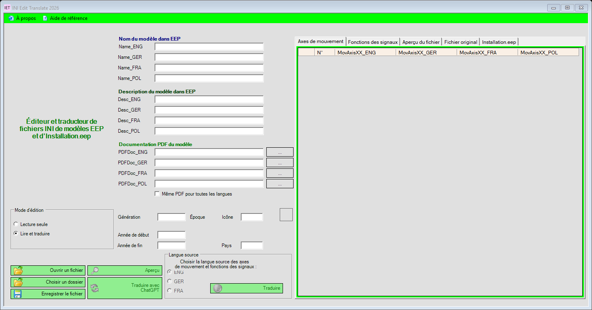

# INI Edit Translate 2026

## Version 2.1.44 : traitement des réponses de traduction ChatGPT

L’application demande explicitement un flux d’événements et vérifie le contenu au lieu
de le refuser uniquement parce que Content-Type manque ou diffère. Les événements SSE
finaux valides et les objets Responses JSON entièrement terminés sont traités. Le HTML,
les objets d’erreur et les réponses incomplètes ou trop grandes ne remplacent aucun texte.
Le diagnostic copiable utilise des catégories fixes, sans jetons ni messages bruts du serveur.

Les requêtes conservent `store: false`, `stream: true` et un tableau `input`, conformément
aux [OpenAI Docs](https://developers.openai.com/siwc/token-sharing-open-source/preview-limitations).
73 contrôles locaux et 43 contrôles de mise à jour réussis, sans appels API réels.
Le prochain test distant doit préciser la réponse effectivement reçue sur cet ordinateur.


## Version 2.1.43 : accès au processus refusé pendant la mise à jour

Si Windows refuse l’accès au processus de l’éditeur, la mise à jour ne continue que
lorsque la liste locale confirme l’absence de son PID. Un processus encore présent,
un échec de vérification ou un délai dépassé empêche l’installation. Les contrôles
d’identité habituels sont conservés. Les prochaines mises à jour utilisent l’outil
du nouveau paquet vérifié à nouveau.

**Réparation unique d’un ancien outil concerné :** fermer l’éditeur, sauvegarder son
`IET.Updater.exe`, puis remplacer uniquement ce fichier à côté de l’EXE de l’éditeur
par le téléchargement individuel de la version GitHub. Relancer l’éditeur et choisir
**À propos → Rechercher des mises à jour**. Ne pas écraser données, dictionnaires ou
paramètres avec le ZIP complet. L’outil individuel figure dans `SHA256SUMS.txt`.


## Version 2.1.42 : conserver les noms de modèles

La traduction conserve les quatre noms de modèles des fichiers INI et d’Installation.eep.
Seuls les descriptions, les libellés des axes et les fonctions des signaux sont traduits ;
les noms ne sont pas envoyés à OpenAI. La conversion voulue des tirets bas en espaces
à l’importation est conservée. Les mauvaises affectations de langue ou de section dans
les descriptions d’installation sont corrigées.

Les erreurs de traduction proposent désormais **Copier l’erreur**. Les erreurs de flux
incluent des codes validés ; les formats de réponse invalides ont des messages distincts.
Les jetons et messages bruts du serveur ne sont pas affichés. La cause du problème
ChatGPT signalé reste à confirmer.


## Version 2.1.41 : diagnostic de connexion et des modèles

Les erreurs indiquent désormais l’étape concernée. Une connexion confirmée est
distinguée d’un échec ultérieur du chargement des modèles. **Copier l’erreur** copie
le message, le statut HTTP, le code d’erreur validé et l’identifiant de requête,
sans jetons ni messages bruts du serveur. Les restrictions du compte, les indisponibilités
temporaires, les erreurs réseau et les formats inattendus ont des messages distincts
en DE/EN/FR. Cette mise à jour aide à diagnostiquer le problème distant signalé ; sa
cause n’est pas encore confirmée. Paramètres, clés API et connexions sont conservés.

[ZIP Windows v2.1.44](https://github.com/rockbaer2007/ini-edit-translate-2026/releases/download/v2.1.44/INI-Edit-Translate-2026-v2.1.44-windows.zip) · [Version et SHA-256](https://github.com/rockbaer2007/ini-edit-translate-2026/releases/tag/v2.1.44)

## Version 2.1.40 : connexion ChatGPT

Inclut la correction du chemin du programme de la version 2.1.39.

Ouvrir **Options → Traduction OpenAI**, puis choisir **Utiliser l’abonnement ChatGPT**.
Cliquer sur **Continuer avec ChatGPT**, se connecter dans le navigateur système et
autoriser soi-même l’utilisation de l’abonnement. Choisir un modèle disponible
pour ce compte et **Enregistrer**. **Autre compte** ajoute une connexion distincte ;
**Se déconnecter** ne déconnecte que le compte choisi.

Les textes sélectionnés sont envoyés à OpenAI. Ce mode utilise le quota ChatGPT
existant et l’autorisation de l’application ; il ne fournit pas de quota illimité
supplémentaire. **Gérer l’utilisation** ouvre les paramètres d’utilisation ChatGPT.
L’éligibilité du compte est vérifiée pendant la connexion réelle.
Aucun passage automatique à l’API facturée séparément en cas d’erreur ou de limite.

La clé API existante est conservée. Les identifiants OAuth sont stockés séparément,
chiffrés avec Windows DPAPI, dans `%LOCALAPPDATA%/UGSo/IET2026/chatgpt-session.dat`.
Aucune clé API n’est nécessaire pour la connexion ChatGPT. Les erreurs de quota API
et de fréquence connues ont désormais des messages distincts.

Les 63 vérifications locales ont réussi avec des réponses OpenAI simulées et un
rappel local isolé. L’autorisation du compte réel et la traduction restent à tester.
[Version et vérifications](https://github.com/rockbaer2007/ini-edit-translate-2026/releases/tag/v2.1.40).
[Documentation officielle](https://developers.openai.com/siwc/token-sharing-open-source/sign-in).

[Deutsch](README.md) · [English](README.en.md) · [Documentation](https://opensource.ugso-software.de/fr/eep/ini-edit-translate-2026/)

Éditeur Windows et traducteur ChatGPT pour les fichiers INI de modèles EEP et
`Installation.eep`, développé par Uwe Grimm / UGSo Software. Version **2.1.44.0**.



## Fonctions

- Modifier les noms et descriptions en anglais, allemand, français et polonais.
- Gérer les axes de mouvement, fonctions des signaux, références PDF et métadonnées.
- Modifier les sections d’installation et comparer l’original à l’aperçu du résultat.
- Traduire directement depuis la langue source vers les trois autres langues avec OpenAI.
- Annuler une traduction ; rejeter les réponses incomplètes et les espaces réservés modifiés,
  tout en conservant les textes existants.
- Sauvegarder automatiquement les fichiers INI existants avant leur remplacement.
- Exporter les tableaux complets en UTF-8 avec BOM et séparateurs de tabulation.
- Textes d’interface allemands, anglais et français révisés.

**Les mises à jour GitHub manuelles avec installation confirmée sont disponibles.** Aucune vérification automatique au démarrage.
Google, LEO, Linguee et DeepL ne sont plus proposés comme services de traduction.

## Téléchargement

[Télécharger le ZIP Windows v2.1.44](https://github.com/rockbaer2007/ini-edit-translate-2026/releases/download/v2.1.44/INI-Edit-Translate-2026-v2.1.44-windows.zip) · [Version GitHub et SHA-256](https://github.com/rockbaer2007/ini-edit-translate-2026/releases/tag/v2.1.44)

Extraire tout le ZIP et lancer `INI Edit Translate 2026.exe`. Windows 11 et
.NET Framework 4.8 suffisent ; Visual Studio sert uniquement à compiler les sources.
Conserver les DLL et dossiers de langues ensemble. Aucun installateur nécessaire.

## Compilation et utilisation

Windows 11, Visual Studio 2026, développement de bureau .NET et Developer Pack .NET Framework 4.8.

```powershell
nuget restore "INI Edit Translate 2026.sln"
MSBuild.exe "INI Edit Translate 2026.sln" /t:Build /p:Configuration=Release
```

Lancer `Ini Edit - Translate/bin/Release/INI Edit Translate 2026.exe`, en conservant
les DLL et dossiers de langues à côté de l’exécutable. Aucun installateur prêt à l’emploi
n’est inclus dans ce dépôt.

Ouvrir **À propos → Paramètres → Traduction OpenAI**, puis saisir sa propre clé API et
le modèle (`gpt-4.1-mini` par défaut). Commencer avec une copie de sauvegarde en mode
**Lecture seule**. Utiliser ensuite **Lire et traduire** ou les boutons de traduction.
Vérifier la langue source et l’aperçu avant d’enregistrer.

OpenAI nécessite Internet et une facturation API distincte. Un abonnement ChatGPT
ne remplace pas cette facturation. L’accès réel à l’API et la qualité des traductions
produites restent à vérifier avec son propre compte.

La fenêtre d’information choisit l’aide révisée `Info.de.rtf`, `Info.en.rtf` ou `Info.fr.rtf` selon la langue de l’interface. Le fichier historique `Info.rtf` est conservé sans modification. L’aide actuelle décrit OpenAI et le programme de référence restauré.

## Mises à jour GitHub

Choisir **À propos → Rechercher des mises à jour** pour consulter la dernière version
publique sur GitHub. Aucune vérification automatique au démarrage. Seule une version
stable plus récente est proposée, avec son numéro et ses notes de publication.

**Télécharger et installer** récupère le ZIP Windows et sa somme SHA-256.
Le téléchargement et la vérification peuvent être annulés avant la fermeture du programme.
Enregistrer les fichiers ouverts et fermer Info_trans avant l’installation, puis confirmer.
Un programme auxiliaire attend la fermeture de l’éditeur, sauvegarde les fichiers existants
et installe le paquet.

Les paramètres et la clé OpenAI chiffrée sont conservés. Les fichiers FDB, CSV, DAT et
de configuration existants de l’aide, ainsi que l’Info.rtf d’origine, sont sauvegardés
sans être remplacés. Les fichiers de modèles restent intacts. En cas d’échec, le programme
tente de restaurer les fichiers déjà remplacés et consigne le résultat. Sauvegardes et
rapports : `%LOCALAPPDATA%/UGSo/IET2026/updates/<identifiant>/`.

Aucun identifiant de serveur nécessaire. Les sommes de contrôle vérifient l’intégrité ;
aucune signature numérique de paquet supplémentaire n’est implémentée.
La version 2.1.38 corrige le passage au programme de mise à jour, y compris entre
x86 et x64. Si l’ancien programme 2.1.37 échoue avant l’installation, extraire
d’abord le ZIP 2.1.38 complet dans un nouveau dossier. Sauvegarder ses données ;
ne pas remplacer les bases et dictionnaires existants par ceux du paquet.
36 tests isolés couvrent le téléchargement, l’annulation, les chemins, la conservation
des données, les fichiers verrouillés et la restauration après une écriture partielle.

## Second programme : Info_trans

Le paquet contient aussi `help/Info_trans.exe`. **Aide de référence** dans
l’éditeur ouvre ce programme dans la langue choisie. La véritable `IET2.FDB`
et son moteur natif Firebird 2.5.8 ont été récupérés dans l’archive de 2019.
Aucune installation séparée d’un serveur Firebird n’est nécessaire.

La base contient 5 entrées de bâtiments, 2 de marchandises et 2 de mises à jour.
Les tables des signaux, matériel roulant, objets de voie et paysage sont vides
dans l’original. Sont aussi inclus : 236 entrées d’icônes, 369 termes techniques
et 2 428 entrées de dictionnaire corrigées. Le nouveau dictionnaire DE/EN/FR ajoute
le français et corrige les termes allemands à partir de la référence anglaise.
Le fichier DE/EN d’origine est conservé. Toutes les questions restantes ont été
résolues ; les corrections figurent dans la [liste de vérification](docs/dictionary-review.md).

`Info_trans` est compilé pour x86, comme les DLL natives. Le fournisseur géré
FirebirdSql.Data.FirebirdClient 7.5.0.0 a été vérifié avec la vraie base Firebird 2.5.8.
Les tests lisent des copies séparées et comparent les sept tables avec l’interface
DE/EN/FR. Le paquet contient la base source inchangée.

Les composants absents ou illisibles sont signalés ; l’import SQL est alors
désactivé. Une sauvegarde locale précède tout import SQL manuel disponible.
La mise à jour automatique du programme reste désactivée.

## Données et vérifications

La configuration est conservée sous `%LOCALAPPDATA%/UGSo/IET2026/openai.json`. La clé
est chiffrée par Windows DPAPI pour le compte Windows actuel. Les variables
`IET_OPENAI_API_KEY` et `OPENAI_API_KEY` sont aussi prises en charge. Les sauvegardes
conservent le nom d’origine sous `%LOCALAPPDATA%/UGSo/IET2026/backups/`.
Les textes sélectionnés sont envoyés à OpenAI avec `store: false`. Les données de
l’ancienne application ne sont ni migrées ni remplacées automatiquement.

40 contrôles locaux couvrent les réponses API simulées, l’annulation, les erreurs,
les espaces réservés, la restauration, l’export et les interfaces DE/EN/FR rendues.
Aucun appel API réel. Exécuter `MSBuild.exe tests/IET.LocalTests.csproj /t:Build`,
puis `tests/bin/IET.LocalTests.exe`. Tous les schémas INI possibles ne sont pas pris en charge.

## Licence

Suite de [IET-Release-Nov19_02](https://github.com/rockbaer2007/IET-Release-Nov19_02),
sous [licence MIT](LICENSE). Le nouveau dépôt n’importe ni l’historique Git ancien,
ni les accès serveur, fichiers d’activation ou bases personnelles.
EEP appartient à son titulaire respectif ; cet outil est un développement indépendant.
