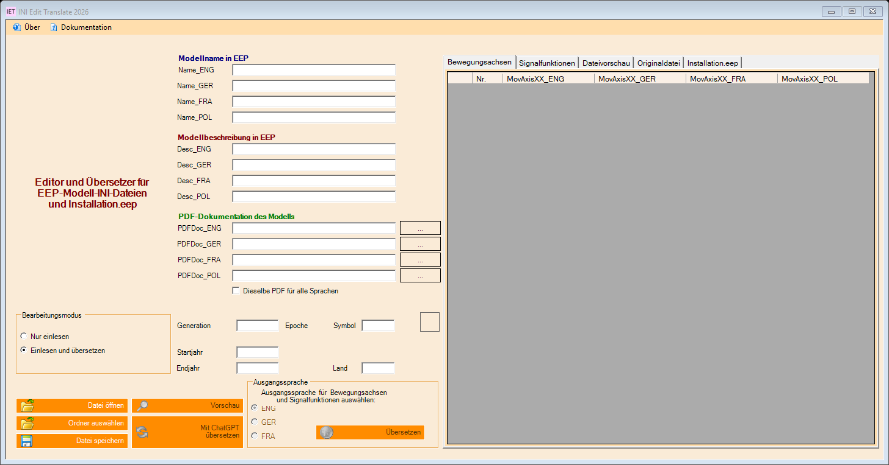

# INI Edit Translate 2026

## Version 2.1.53: Bahn-Abkürzungen und Konstrukteurskennungen

20 Bahn-Abkürzungen werden jetzt anhand einer festen lokalen Zuordnung übersetzt:
in Modellnamen sowie in den über den gewählten Anbieter übersetzten Texten.
EW bedeutet Einfachweiche, auch ohne folgende Gradzahl.
Beispiel: `GK3 DKW DR DB (V8)[e]EEP16.2` wird auf Französisch
zu `GK3 TJD DR DB (V8)[e]EEP16.2`.

Die mitgelieferte Startliste enthält 272 eindeutige dreistellige Konstrukteurskennungen.
Beim ersten Programmstart wird eine externe UTF-8-Datei angelegt:
`%LOCALAPPDATA%\UGSo\IET2026\constructor-codes.txt`.
Neue Kennungen dort mit zwei Buchstaben und einer Ziffer, jeweils eine pro Zeile,
ergänzen und das Programm neu starten. Updates überschreiben die Benutzerdatei nicht.
Ergänzungen werden mit der mitgelieferten Grundliste zusammengeführt. Leerzeilen,
Kommentare und ungültige Zeilen werden ignoriert; unlesbare Dateien bleiben erhalten
und die Grundliste dient als Rückfallebene. Kennungen bleiben mit und ohne Klammern an jeder Position erhalten.
Die bisherige allgemeine Erkennung weiterer Kennungen bleibt zusätzlich aktiv.
DR, DB, Typbezeichnungen, Versionshinweise wie `(V8)` oder `(v8.2)`,
EEP-Versionen und `[e]` bleiben unverändert.

| DE | EN | FR | PL |
| --- | --- | --- | --- |
| DKW | DSS | TJD | Rkpd |
| EKW | SS | TJS | Rkp |
| EW | single turnout | BS | Rz |
| ABW | contrary-flexure turnout | ABW* | Rłd |
| IBW | similar-flexure turnout | IBW* | Rłj |
| BW | locomotive depot | dépôt de locomotives | lokomotywownia |
| Bf | station | gare | stacja |
| Hbf | main station | gare principale | dworzec główny |
| Hp | halt | halte ferroviaire | przystanek osobowy |
| Gbf | freight station | gare de marchandises | stacja towarowa |
| Rbf | marshalling yard | gare de triage | stacja rozrządowa |
| Abzw | junction | bifurcation | posterunek odgałęźny |
| BÜ | level crossing | passage à niveau | przejazd kolejowo-drogowy |
| Stw | signal box | poste d’aiguillage | nastawnia |
| EG | station building | bâtiment voyageurs | budynek dworca |
| OL | overhead line equipment | caténaire | sieć trakcyjna |
| Gl. | track | voie | tor |
| Bstg. | platform | quai | peron |
| DWW | three-way turnout | branchement à trois voies | rozjazd potrójny |
| Kr. | diamond crossing | traversée de voies | skrzyżowanie torów |

*Für ABW/IBW bleibt Französisch bis zur fachlichen Prüfung beim Originalkürzel.
Die übrigen Einträge verwenden belegte Kürzel oder ausgeschriebene Übersetzungen;
sie behaupten keine weltweit einheitliche Kürzelnorm.
Als fremdsprachige Eingaben werden zusätzlich DS/DSS/SS, TJD/TJS/BS,
Rkpd/Rkp/Rz/Rłd/Rłj, PO, Jn, PODG, LC, PN, BV und OLE erkannt.
Mehrdeutiges polnisches ST/St wird nicht automatisch zugeordnet.
Hp bedeutet hier Haltepunkt, Kr. bedeutet Gleiskreuzung; technische Typen wie
`Hp0`, `DKW190` und Kennungen wie `DKW_190` werden nicht zerlegt.

Die geprüften Begriffe werden bei Online-Übersetzungen vorübergehend durch
geschützte Platzhalter ersetzt und erst nach erfolgreicher Prüfung in der Zielsprache
eingesetzt. Das funktioniert auch über die englische Zwischensprache. Fehler oder
veränderte Platzhalter führen zu keiner Teilübernahme; Originaldateien,
Einstellungen und Zugangsdaten bleiben erhalten. Backup vor der Änderung erstellt.
MyMemory bleibt die Voreinstellung für neue Konfigurationen.

111 lokale Prüfungen bestanden, einschließlich aller 272 Kennungen, DE/EN/FR/PL,
Import/Speichern/erneutem Einlesen, Versionshinweisen und Fehlerfällen.
Keine echten API-Anfragen in diesen Prüfungen.
Im vollständigen ZIP liegen die Zuordnung und Kontrollliste unter
`docs/railway-glossary.md` und `docs/constructor-codes.txt`.


## Version 2.1.52: beschreibende Wörter in Modellnamen

Beschreibende Wörter werden jetzt auch in Modellnamen übersetzt, selbst wenn die
Modellbeschreibung leer ist. Beispiel:

| DE | EN | FR | PL |
| --- | --- | --- | --- |
| Haus Helios Typ4 UD1 | House Helios Typ4 UD1 | Maison Helios Typ4 UD1 | Dom Helios Typ4 UD1 |

Zum Schutz der Eigennamen arbeitet die Namensübersetzung lokal mit einer begrenzten,
geprüften Wortliste. Unbekannte Wörter und Namensbestandteile werden unverändert
übernommen und nicht zur Namensübersetzung an einen Online-Dienst geschickt.
Das ist keine allgemeine automatische Eigennamenerkennung: weitere beschreibende
Wörter müssen geprüft ergänzt werden. Vorhandene Namen ohne erkannten beschreibenden
Anteil werden nicht überschrieben. Typbezeichnungen, Konstrukteurskennungen,
EEP-Versionen, `[e]`, Trennzeichen und Schreibweise geschützter Bestandteile bleiben erhalten.
Die noch gesammelten Fachabkürzungen sind in dieser Änderung nicht vorweggenommen.

Beschreibungen verwenden weiterhin den gewählten Übersetzungsanbieter. Namen und
Beschreibungen werden zusammen erst nach erfolgreichem Abschluss übernommen.
Bei einem Fehler bleiben die bisherigen Inhalte erhalten. Der Button heißt jetzt
anbieterneutral **Texte übersetzen**.

**MyMemory/translated.net ist die Voreinstellung für neue Konfigurationen.**
Eine bereits gespeicherte Anbieterwahl sowie API-Schlüssel, Konten und Modelle
werden erhalten. Zum bewussten Wechsel **Über → Einstellungen → Übersetzungseinstellungen
→ MyMemory → Speichern** wählen.

105 lokale Prüfungen bestanden, einschließlich DE/EN/FR/PL, leerer Beschreibung,
Schutz von `Helios Typ4 UD1 (GK3) EEP16.2[e]`, Fehlerverhalten und Speichern/erneutem Einlesen.
Vorher Backup erstellt; Originaldateien und Zugangsdaten bleiben erhalten.

## Version 2.1.51: Hinweis bei Ordnerauswahl

Beim Auswählen eines Ordners im Dateibaum erscheint **„Bitte eine INI-Datei auswählen.“**
Die bereits geladenen Modelltexte, Tabellen, Vorschau und ausgewählte Datei bleiben
erhalten. Ein Ordner wird nicht mehr als Datei gelesen; es startet keine Übersetzung.

Das gilt für den Hauptordner und beliebig benannte Unterordner, auch für Ordner mit
`.ini` im Namen. Gelöscht gewordene Dateien und andere Dateitypen erhalten ebenfalls
den Auswahlhinweis. Nur eine vorhandene INI-Datei wird geöffnet; `.INI` wird ebenfalls erkannt.
Die Auswahl verwendet den ausgewählten Baumknoten statt der Mausposition und funktioniert
damit auch bei Tastaturbedienung. Hinweis in Deutsch, Englisch und Französisch.

101 lokale Prüfungen bestanden, einschließlich Datenerhalt bei Ordnerauswahl in
allen drei Sprachen sowie Öffnen einer INI-Datei ohne Mauspositionsprüfung.
Vorher Backup erstellt; persönliche Daten und Zugangsdaten bleiben erhalten.

## Version 2.1.50: EEP-Steuerzeichen, Kennungen und Versionen schützen

`[e]` bleibt ein EEP-Zeilenumbruch-Steuerzeichen und wird weder übersetzt noch in
einen echten Zeilenumbruch umgewandelt. Schreibweise, Anzahl und Reihenfolge der
geschützten Markierungen werden geprüft.

Konstrukteurskennungen werden nach Buchstaben-/Zahlenmustern erkannt, ohne feste
Namensliste. Geschützt sind beispielsweise `(GK3)`, `(AG3)`, `(DL1)` und auch
ältere Schreibweisen ohne Klammern am Anfang, mitten im Text oder am Ende.
Es wird keine Kennung ergänzt, wenn keine vorhanden ist. Normale Zusätze wie
`(Winter)` bleiben übersetzbar. Rein aus Buchstaben bestehende Sonderkennungen
lassen sich ohne eine zusätzliche Liste nicht zuverlässig von normalen Wörtern unterscheiden.

Spielversionen wie `EEP16.2`, `eep16.2` oder `EEP 16.2` bleiben einschließlich
Groß-/Kleinschreibung und Satzzeichen erhalten. MyMemory erhält diese geschützten
Teile nicht zur Übersetzung; bei OpenAI/ChatGPT werden veränderte oder zusätzlich
erfundene Kennungen und Steuerzeichen abgelehnt. Der bestehende Rücksetzschutz bleibt aktiv.

Ein Konfigurationseintrag aus 2.1.49 verursachte beim echten App-Start einen Lesefehler.
Das ist behoben und wird nun mit der ausgelieferten Konfiguration geprüft.
**Falls 2.1.49 nicht mehr startet:** Die bisherige `INI Edit Translate 2026.exe.config`
sichern. Die zusätzliche Konfigurationsdatei aus Release 2.1.50 herunterladen, in
`INI Edit Translate 2026.exe.config` umbenennen und neben der EXE ersetzen.
Danach starten und das normale Update auf 2.1.50 installieren. Keine INI-Dateien,
Datenbanken oder persönlichen Einstellungen ersetzen.

99 lokale Prüfungen bestanden. Ein eigener Installation.eep-Test mit Kennung am Anfang,
Version, Klammerkennung und zwei `[e]` wurde tatsächlich über MyMemory übersetzt,
gespeichert und erneut eingelesen. Originaldateien und Zugangsdaten bleiben erhalten.

## Version 2.1.49: letzten Pfad erhalten

Unter **Über → Einstellungen** kann **Letzten Pfad erhalten** aktiviert werden.
Nach **Speichern** bleibt der zuletzt gewählte Ordner über Neustarts und Updates
erhalten. Die Ordnerliste sowie die Dialoge für Modell-INI und Installation.eep
beginnen wieder dort. Dateien werden dabei nicht automatisch geöffnet oder übersetzt.

Die Option ist standardmäßig ausgeschaltet. Ist ein gespeicherter Ordner oder ein
Netzlaufwerk nicht erreichbar, erscheint ein Hinweis; der gespeicherte Pfad bleibt
für den nächsten Start erhalten. Vorhandene Daten und Zugangsdaten bleiben erhalten.
94 lokale Prüfungen einschließlich Speicherung/erneutem Laden, Opt-out,
fehlendem Ordner und Oberfläche DE/EN/FR bei 100/150 Prozent bestanden.

## Version 2.1.48: Teilset-Namen wieder übersetzen

Die Namen und Beschreibungen der fünf Teilsets `Install_00` bis `Install_04`
werden wieder übersetzt. Geschützt bleiben ausschließlich die Modellnamen im
Modellbereich. Ausgangstexte bleiben erhalten; Deutsch und Französisch nutzen
weiterhin Englisch als Zwischensprache.

Alle fünf Übersetzungsbuttons und der automatische Import verwenden dieselbe
geprüfte Zuordnung. Der Button des zweiten Teilsets bearbeitet wieder dessen
eigene Felder. Ein Teilset wird erst nach vollständiger Übersetzung übernommen;
bei Fehler oder Abbruch bleiben seine Namen und Beschreibungen erhalten.

91 lokale Prüfungen bestanden. Ein eigener Installations-Test mit dem Namen
„Detailmodell Großdiesellokomotive V140 001 DRG“ wurde tatsächlich über MyMemory
übersetzt, gespeichert und erneut eingelesen; Modellnamen und ein zusätzliches
INI-Feld blieben erhalten. Die Datei auf dem entfernten Spielerechner wurde dabei
nicht verändert.

## Version 2.1.47: MyMemory und Englisch als Zwischensprache

Unter **Optionen → Übersetzungseinstellungen** stehen OpenAI-API, ChatGPT-Abo
und **MyMemory** zur Wahl. MyMemory benötigt Internet, aber keinen Schlüssel und kein
Konto. Eine optionale E-Mail-Adresse wird mit jeder Anfrage an MyMemory gesendet:
laut Anbieter 5.000 Zeichen täglich anonym, bis zu 50.000 mit gültiger E-Mail.
Jede Zielsprache zählt separat; längere Texte werden in Abschnitte mit höchstens
500 UTF-8-Bytes zerlegt. Ein flüchtiger Cache vermeidet Wiederholungen innerhalb einer Aktion.

Deutsch ist die Voreinstellung. Die ausgewählte Oberfläche bestimmt die anfängliche
Ausgangssprache; die Quellwahl für Achsen/Signalfunktionen bleibt bedienbar.
Deutsch und Französisch werden zuerst nach Englisch übersetzt; weitere Zielsprachen
entstehen aus diesem englischen Zwischenstand. Die gewählte Ausgangssprache bleibt erhalten.
Das gilt für alle Anbieter. Modellnamen werden weiterhin nicht übersetzt.

MyMemory kann übermittelte Texte langfristig speichern. Die App ruft ausschließlich
die Übersetzungsabfrage auf und veröffentlicht keine zusätzlichen Wörterbucheinträge.
Es gibt keinen automatischen Anbieterwechsel. Bereits gespeicherte API-Schlüssel,
ChatGPT-Verbindungen, Modelle und Wörterbücher bleiben erhalten.
Polnische Sonderzeichen werden beim INI-Speichern über Unicode erhalten; wenn nötig
wird die gesicherte Ausgabedatei in UTF-16 mit BOM gespeichert. Die reale EEP-Verarbeitung
einer solchen Datei wurde hier nicht geprüft.

90 lokale Prüfungen sowie Einlesen, echte MyMemory-Übersetzung und Speichern einer
Kopie der bereitgestellten Beispiel-INI wurden geprüft. Die Originaldatei bleibt unverändert.
Maschinelle Fachübersetzungen vor Verwendung prüfen.

[MyMemory API](https://mymemory.translated.net/doc/spec.php) ·
[Kontingente](https://mymemory.translated.net/doc/usagelimits.php) ·
[Datennutzung](https://mymemory.translated.net/terms-and-conditions)

## Version 2.1.46: fertige Stream-Texte erhalten

Fehlt der Übersetzungstext im letzten Abschlussereignis, berücksichtigt die App nun
die zuvor abgeschlossenen `response.output_item.done`, `response.content_part.done`
und `response.output_text.done`. Übernommen wird erst nach `response.completed` mit
Status `completed`. Bis dahin gesammelte Text-Deltas können erst dann die vollständige
Sprach-/JSON-Prüfung durchlaufen. Deltas ohne Gesamtabschluss, Fehler, Abbrüche, Ablehnungen und lückenhafte
Textteile werden nicht als erfolgreiche Übersetzung verwendet.

Eine weiterhin leere Antwort bekommt eine eigene Meldung mit Transport und festen
Ereigniszählern, ohne Antworttexte, Tokens oder Benutzerkennungen. Der konkrete
Ereignisverlauf auf dem entfernten Rechner muss noch bestätigt werden. 78 lokale
Prüfungen bestanden ohne echte API-Aufrufe. Modellnamen und Originaldaten bleiben erhalten.

[OpenAI Docs zu Streaming-Ereignissen](https://developers.openai.com/api/reference/resources/responses/streaming-events).


## Version 2.1.45: JSON-Ausgabe der Übersetzung

Die Anweisung fordert nun ausdrücklich ein JSON-Objekt mit den drei Zielsprachen
an; das strenge Schema bleibt aktiv. Ein einzelner JSON-Markdown-Codeblock darf
entfernt werden, bevor dieselbe vollständige Sprachprüfung erfolgt. Erklärtexte,
beschädigtes JSON, doppelte oder zusätzliche Sprachschlüssel werden nicht übernommen.

Statt eines allgemeinen JsonReaderException zeigt die Diagnose, ob die Übersetzungsausgabe,
die API-Antwort, die Tokenantwort oder die Identitätsschlüssel betroffen sind.
Es werden keine Originalantworten oder Zugangsdaten angezeigt. 75 lokale Prüfungen
bestanden ohne echte API-Aufrufe. Der genaue Ursprung des gemeldeten Fehlers muss
auf dem entfernten Rechner bestätigt werden. Modellnamen bleiben unverändert.


## Version 2.1.44: Antwortformat bei ChatGPT-Übersetzung

Die App fordert den Ereignisstream ausdrücklich an und prüft den Antwortinhalt,
statt ihn allein wegen eines fehlenden oder abweichenden Content-Type abzulehnen.
Gültige SSE-Abschlussereignisse und vollständig abgeschlossene Responses-JSON-Objekte
werden verarbeitet. HTML, Fehlerobjekte, unvollständige Ergebnisse und zu große
Antworten ersetzen keine Texte. Die kopierbare Diagnose nennt eine feste Kategorie
für Antworttyp und Inhalt; Tokens und rohe Servertexte bleiben ausgeschlossen.

Die Anfrage bleibt `store: false`, `stream: true`, mit `input` als Array gemäß
[OpenAI Docs](https://developers.openai.com/siwc/token-sharing-open-source/preview-limitations).
73 lokale Prüfungen und 43 Updater-Prüfungen bestanden ohne echte API-Aufrufe.
Welche Antwort der entfernte Rechner tatsächlich liefert, muss der nächste Test zeigen.


## Version 2.1.43: Update bei verweigertem Prozesszugriff

Der Updater behandelt „Zugriff verweigert“ beim Warten auf das Ende des Editors.
Er fährt nur fort, wenn die lokale Prozessliste bestätigt, dass die Prozess-ID nicht
mehr existiert. Solange der Prozess vorhanden ist oder die Prüfung fehlschlägt,
beginnt keine Installation. Die normale Identitätsprüfung bleibt erhalten.
Künftige Updates starten den Updater aus dem erneut geprüften neuen Paket.

**Einmalige Reparatur bei betroffenem altem Updater:** Editor schließen, die einzelne
`IET.Updater.exe` aus dem GitHub-Release herunterladen und nur diese Datei neben der
Editor-EXE ersetzen (vorher die bisherige Datei sichern). Danach den Editor starten
und **Über → Nach Updates suchen** wählen. Daten, Wörterbücher und Einstellungen
nicht mit dem kompletten ZIP überschreiben. Die einzelne EXE ist ebenfalls in
`SHA256SUMS.txt` aufgeführt.


## Version 2.1.42: Modellnamen erhalten

Die Übersetzung lässt alle vier Modellnamen in Modell-INI und Installation.eep
unverändert. Nur Beschreibungen, Bewegungsachsen und Signaltexte werden übersetzt;
Namen werden nicht an OpenAI gesendet. Die gewollte Umwandlung von Unterstrichen
in Leerzeichen beim Einlesen bleibt erhalten. Falsche Sprach-/Abschnittszuordnungen
bei Installationsbeschreibungen sind korrigiert.

Auch Fehler während der eigentlichen Übersetzung können jetzt über **Fehler kopieren**
übernommen werden. Streamfehler zeigen geprüfte Fehlercodes; ungültige Antwortformate
haben eigene Meldungen. Tokens und rohe Servertexte werden nicht angezeigt. Die
Ursache des gemeldeten ChatGPT-Fehlers ist weiterhin nicht bestätigt.


## Version 2.1.41: Diagnose bei Anmeldung und Modellabruf

Fehler nennen jetzt den betroffenen Schritt. Eine bestätigte Anmeldung wird von einem
anschließenden Fehler beim Modellabruf unterschieden. **Fehler kopieren** kopiert die
Meldung mit HTTP-Status, geprüftem Fehlercode und Anfrage-ID, ohne Tokens oder rohe
Servertexte. Kontobeschränkungen, vorübergehende Nichtverfügbarkeit, Netzwerkfehler
und ein unerwartetes Modelllistenformat erhalten eigene Meldungen in DE/EN/FR.
Dies grenzt den gemeldeten Fehler auf dem entfernten Rechner ein; dessen Ursache
ist noch nicht bestätigt. Einstellungen, API-Schlüssel und Verbindungen bleiben erhalten.

[Windows-ZIP v2.1.53](https://github.com/rockbaer2007/ini-edit-translate-2026/releases/download/v2.1.53/INI-Edit-Translate-2026-v2.1.53-windows.zip) · [Release und SHA-256](https://github.com/rockbaer2007/ini-edit-translate-2026/releases/tag/v2.1.53)

## Version 2.1.40: ChatGPT-Anmeldung

Die Korrektur der Programmpfad-Eingabe aus 2.1.39 ist enthalten.

Unter **Optionen → OpenAI-Übersetzung** lässt sich der Zugang auswählen:
**OpenAI-API · separate Abrechnung** oder **ChatGPT-Abo verwenden**.
Für die Abo-Nutzung **Mit ChatGPT fortfahren** wählen, im Standardbrowser anmelden
und die Abo-Nutzung selbst freigeben. Anschließend ein für das Konto verfügbares
Modell wählen und **Speichern**. **Anderes Konto** ergänzt eine getrennte Verbindung;
**Abmelden** beendet nur die gewählte Verbindung.

Ausgewählte Modelltexte werden an OpenAI gesendet. Die Abo-Variante nutzt das
vorhandene ChatGPT-Kontingent und die erteilte App-Freigabe; sie hat kein eigenes
unbegrenztes Kontingent. **Nutzung verwalten** öffnet die ChatGPT-Nutzungsübersicht.
Berechtigung und Verfügbarkeit werden bei der echten Anmeldung geprüft.
Bei Fehlern oder Abo-Limits gibt es keinen automatischen Wechsel zur kostenpflichtigen API.

API-Schlüssel bleiben in der bestehenden Konfiguration erhalten. Neue OAuth-Zugangsdaten
liegen separat, mit Windows-DPAPI verschlüsselt, unter
`%LOCALAPPDATA%/UGSo/IET2026/chatgpt-session.dat`.
Die Abo-Anmeldung benötigt keinen API-Schlüssel. HTTP-429-Meldungen unterscheiden nun
bekannte API-Kontingent- und Anfragelimit-Fehler.

63 lokale Prüfungen mit simulierten OpenAI-Antworten und einem eigenen lokalen
Anmelderückweg bestanden; keine echte Übersetzung mit einem ChatGPT-Konto ausgelöst.
Die echte Kontoanmeldung, Freigabe und Übersetzung sind anschließend noch zu prüfen.
[Release und Prüfergebnisse](https://github.com/rockbaer2007/ini-edit-translate-2026/releases/tag/v2.1.40).

Offizielle Grundlagen: [Anmeldung](https://developers.openai.com/siwc/token-sharing-open-source/sign-in),
[Modelle und Streaming](https://developers.openai.com/siwc/token-sharing-open-source/models-and-inference),
[Vorschaugrenzen](https://developers.openai.com/siwc/token-sharing-open-source/preview-limitations).

**EEP-Modellbeschreibungen bearbeiten und mit ChatGPT übersetzen.**

[English](README.en.md) · [Français](README.fr.md) · [Funktionsbeschreibung](https://opensource.ugso-software.de/eep/ini-edit-translate-2026/)

Windows-Anwendung für EEP-Modell-INI-Dateien und `Installation.eep`, entwickelt
von Uwe Grimm / UGSo Software. Die 2026-Fassung führt den bisherigen INI-Editor
mit OpenAI-Übersetzung und bereinigter Oberfläche fort.



## Funktionen

- Modellnamen und Beschreibungen für Englisch, Deutsch, Französisch und Polnisch bearbeiten.
- Bewegungsachsen, Signalfunktionen, PDF-Verweise und Modellmetadaten anzeigen und bearbeiten.
- Installationsabschnitte aus `Installation.eep` bearbeiten.
- Originaldatei und erzeugte Dateivorschau vergleichen.
- Texte mit der OpenAI Responses API direkt aus der Ausgangssprache in die drei anderen Sprachen übersetzen.
- Übersetzungen abbrechen; bei Fehlern oder veränderten Platzhaltern bisherige Texte wiederherstellen.
- Vor dem Überschreiben einer vorhandenen INI-Datei automatisch eine Sicherung anlegen.
- Tabellen vollständig als tabulatorgetrennte UTF-8-Dateien mit BOM exportieren.
- Oberfläche mit geprüften deutschen, englischen und französischen Texten.

**Version 2.1.53.0. Manuelle GitHub-Updates mit bestätigter Installation.** Es gibt keine automatische Updateprüfung beim Start. Google, LEO,
Linguee und DeepL werden nicht mehr als Übersetzungsdienste angeboten.

## Download

[Windows-ZIP v2.1.53 herunterladen](https://github.com/rockbaer2007/ini-edit-translate-2026/releases/download/v2.1.53/INI-Edit-Translate-2026-v2.1.53-windows.zip) · [GitHub-Release und SHA-256](https://github.com/rockbaer2007/ini-edit-translate-2026/releases/tag/v2.1.53)

ZIP vollständig entpacken und `INI Edit Translate 2026.exe` starten. Windows 11 mit
.NET Framework 4.8 genügt; Visual Studio ist für die fertige Anwendung nicht nötig.
DLLs und Sprachordner zusammen lassen. Das Paket benötigt keinen Installer.

## Voraussetzungen und Build

- Windows 11 und .NET Framework 4.8.
- Visual Studio 2026 mit „.NET-Desktopentwicklung“ und .NET Framework 4.8 Developer Pack.
- NuGet-Paketwiederherstellung für Newtonsoft.Json; die bisherigen INI-Bibliotheken liegen im Projekt.

```powershell
nuget restore "INI Edit Translate 2026.sln"
MSBuild.exe "INI Edit Translate 2026.sln" /t:Build /p:Configuration=Release
```

Danach `Ini Edit - Translate/bin/Release/INI Edit Translate 2026.exe` starten.
Beim Weitergeben den gesamten Ausgabeordner einschließlich DLLs und Sprachordnern
verwenden. Ein vorgefertigtes Installationspaket ist in diesem Repository nicht enthalten.

## Erste Schritte

1. Unter **Über → Einstellungen** die gewünschte Sprache und den Bearbeitungsmodus wählen.
2. **Übersetzungseinstellungen** öffnen und MyMemory, OpenAI-API oder ChatGPT-Abo wählen.
   Voreinstellung: `gpt-4.1-mini`. Ein leeres Schlüsselfeld erhält den bisherigen Schlüssel.
3. Eine eigene Datei zunächst mit **Nur einlesen** öffnen und die Inhalte prüfen.
4. Zum Übersetzen den Modus **Einlesen und übersetzen** verwenden oder die entsprechenden
   Übersetzungsschaltflächen betätigen. Bei Bewegungsachsen und Signalfunktionen die
   vorhandene Ausgangssprache auswählen.
5. Ergebnis in der Vorschau prüfen und bewusst speichern.

Die API erfordert Internet und eigene OpenAI-API-Abrechnung. Ein ChatGPT-Abonnement
ersetzt diese API-Abrechnung nicht. Ein echter API-Aufruf und die sprachliche Qualität
der erzeugten Modelltexte müssen mit dem eigenen Zugang geprüft werden.

Der Info-Dialog wählt die geprüfte Hilfe `Info.de.rtf`, `Info.en.rtf` oder `Info.fr.rtf` passend zur Oberflächensprache. Die historische `Info.rtf` bleibt unverändert als Original erhalten. Die aktuellen Hilfetexte beschreiben OpenAI und die wiederhergestellte Nachschlagehilfe.

## GitHub-Updates

Unter **Über → Nach Updates suchen** wird das neueste öffentliche GitHub-Release
abgefragt. Es gibt keine automatische Prüfung beim Programmstart. Nur eine neuere
stabile Version wird angeboten; Versionsnummer und Release-Notizen werden angezeigt.

**Herunterladen und installieren** lädt die Windows-ZIP samt SHA-256-Prüfsumme.
Download und Paketprüfung sind abbrechbar und erfolgen vor dem Schließen der Anwendung.
Vor der Installation müssen offene Dateien gespeichert und Info_trans geschlossen sein.
Die Installation startet erst nach Bestätigung. Ein separates Hilfsprogramm wartet auf
das Ende des Editors, sichert die bisherigen Dateien und installiert das Paket.

Einstellungen und der verschlüsselte OpenAI-Schlüssel bleiben erhalten. Vorhandene
IET2.FDB-, CSV-, DAT- und Konfigurationsdateien der Nachschlagehilfe sowie die ursprüngliche
Info.rtf werden gesichert und nicht ersetzt. Eigene Modelldateien bleiben unangetastet.
Bei einem Installationsfehler wird die Wiederherstellung der bereits ersetzten Dateien
versucht; ein Bericht nennt das Ergebnis. Sicherungen und Berichte liegen unter
`%LOCALAPPDATA%/UGSo/IET2026/updates/<Kennung>/`.

Der Updater benötigt keine Serverzugangsdaten. Prüfsummen dienen der Integritätsprüfung;
es ist keine zusätzliche digitale Paketsignatur implementiert.
2.1.38 korrigiert die Prozessübergabe beim Update, auch zwischen x86 und x64.
Falls der alte 2.1.37-Updater vor der Installation scheitert, das vollständige
2.1.38-ZIP zunächst in einen neuen Ordner entpacken. Eigene Daten vorher sichern;
vorhandene Datenbanken und Wörterbücher nicht durch Paketdateien ersetzen.

36 isolierte Updateprüfungen decken Download, Abbruch, Paketpfade, Datenerhalt,
gesperrte Dateien und Rücknahme nach einem teilweisen Schreibfehler ab.

## Zweites Programm: Info_trans

Das Paket enthält auch `help/Info_trans.exe`. **Nachschlagehilfe** im Haupteditor
öffnet dieses separate Programm in der gewählten Sprache. Die echte `IET2.FDB`
und die zugehörige native Firebird-2.5.8-Laufzeit wurden aus dem Archiv von 2019
übernommen. Eine separate Firebird-Serverinstallation ist nicht nötig.

Die Datenbank enthält 5 Immobilien- und 2 Gütereinträge sowie 2 Updateeinträge.
Die Tabellen für Signale, Rollmaterial, Gleisobjekte und Landschaft sind im
Original leer. Zusätzlich sind 236 Iconeinträge, 369 technische Begriffe und
2.428 bereinigte Wörterbucheinträge enthalten. Das neue „Wörterbuch DE/EN/FR“
ergänzt Französisch und korrigiert deutsche Begriffe anhand der englischen Quelle.
Die ursprüngliche DE/EN-Datei bleibt erhalten. Alle offenen Rückfragen sind geklärt;
die bestätigten Korrekturen stehen in [der Prüfliste](docs/dictionary-review.md).

`Info_trans` wird passend zu den nativen DLLs für x86 gebaut. Die verwaltete DLL
FirebirdSql.Data.FirebirdClient 7.5.0.0 wurde mit der echten Firebird-2.5.8-Datenbank
geprüft. Tests lesen nur getrennte Datenbankkopien und vergleichen alle sieben
Tabellen mit der Anzeige in DE/EN/FR. Das Paket enthält die unveränderte Quelldatenbank.

Fehlende oder nicht ladbare Bestandteile werden angezeigt. SQL-Import bleibt dann
gesperrt; vor einem verfügbaren manuellen SQL-Import wird die Datenbank lokal gesichert.
Die automatische Programmaktualisierung bleibt deaktiviert.

## Daten und Sicherungen

- OpenAI-Konfiguration: `%LOCALAPPDATA%/UGSo/IET2026/openai.json`.
- Der API-Schlüssel wird mit Windows-DPAPI für das aktuelle Windows-Konto verschlüsselt.
- Optionaler Schlüssel über `IET_OPENAI_API_KEY` oder `OPENAI_API_KEY`.
- Dateisicherungen: `%LOCALAPPDATA%/UGSo/IET2026/backups/<Zeitstempel>/<Originaldateiname>`.
- Nur die ausdrücklich übersetzten Texte werden an OpenAI gesendet; die API-Anfrage verwendet `store: false`.
- Vorhandene Daten und Registrierungen der alten Anwendung werden nicht automatisch migriert oder überschrieben.

Dateien und Projekte vor der ersten Bearbeitung zusätzlich sichern. Die Anwendung
erkennt nicht jedes denkbare INI-Schema und ersetzt keine inhaltliche Prüfung des Modells.

## Prüfstand

Debug- und Release-Build mit Visual Studio 2026/.NET Framework 4.8. 41 lokale Prüfungen
mit simulierten API-Antworten: Abbruch, HTTP-Fehler, Antwortprüfung, Platzhalter, Cache,
DPAPI, Wiederherstellung, Tabellenexport und gerenderte Oberflächen für DE/EN/FR.
Keine echten API-Aufrufe in der Testsuite.

```powershell
MSBuild.exe tests/IET.LocalTests.csproj /t:Build
./tests/bin/IET.LocalTests.exe
```

Die neue Veröffentlichung enthält keine alte Git-Historie, Serverzugänge,
Registrierungsdateien oder persönliche Datenbanken. Die bisherigen Projekte bleiben erhalten.

## Herkunft und Lizenz

Fortführung von [IET-Release-Nov19_02](https://github.com/rockbaer2007/IET-Release-Nov19_02).
MIT-Lizenz; ursprünglicher Copyright-Hinweis in [LICENSE](LICENSE).
EEP ist ein Produkt seines jeweiligen Rechteinhabers; dieses Werkzeug ist eine unabhängige Entwicklung.

[Offizielle OpenAI-Dokumentation](https://developers.openai.com/api/docs/guides/text)
